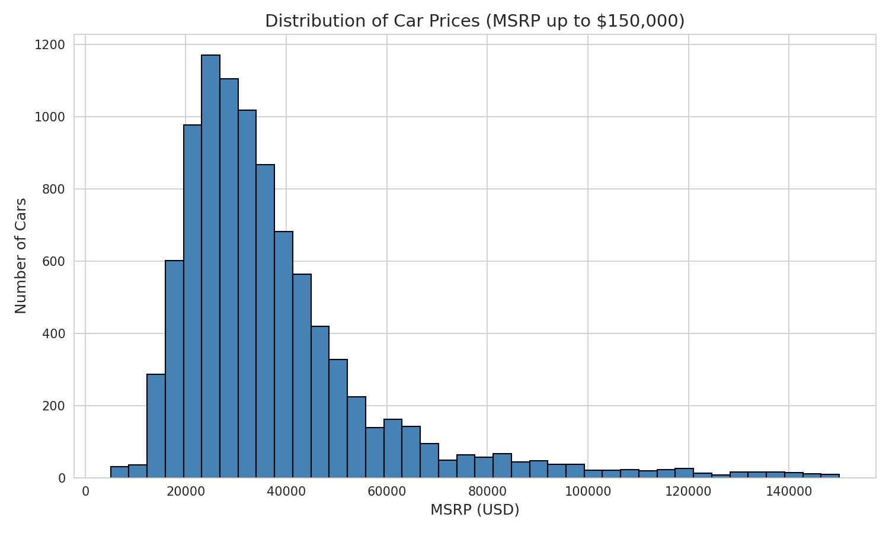
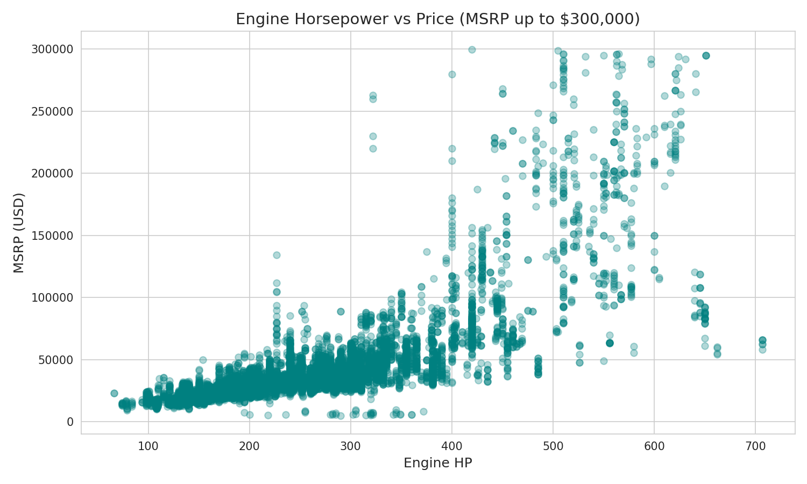
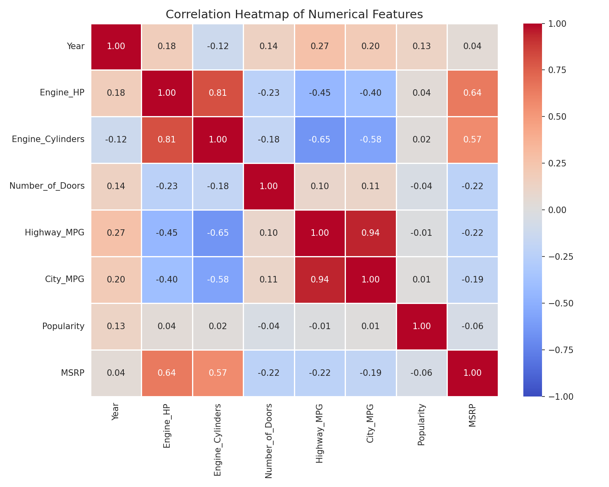
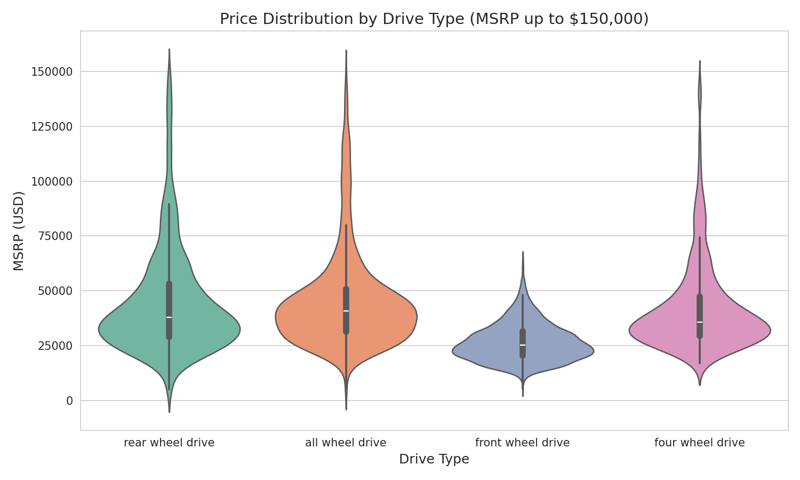

# Car Price Analysis: Python Data Analysis and Visualization

**Devixo Solutions AI/ML Internship Program | Task 01**

## Project Objective
To perform a complete data analysis workflow on a real-world car dataset: data loading, cleaning, exploratory data analysis (EDA), statistical analysis, visualization and insight generation, in order to understand what drives car prices.

## Dataset Description
- **Name:** Car Features and MSRP
- **Source:** Kaggle (published by CooperUnion)
- **Original size:** 11,914 rows and 16 columns
- **Cleaned size:** 9,877 rows and 16 columns
- **Features:** Make, Model, Year, Fuel Type, Engine HP, Engine Cylinders, Transmission Type, Driven Wheels, Number of Doors, Market Category, Vehicle Size, Vehicle Style, Highway MPG, City MPG, Popularity and MSRP (price)

## Technologies Used
- Python 3
- Google Colab / Jupyter Notebook

## Libraries Used
- Pandas (data loading, cleaning, analysis)
- NumPy (numerical operations)
- Matplotlib (visualizations)
- Seaborn (statistical visualizations)

## Project Workflow
1. Dataset selection
2. Data loading and understanding
3. Data cleaning: missing values, duplicates, data types, renaming columns, invalid values
4. Exploratory data analysis and statistics (mean, median, mode, standard deviation, variance, correlation)
5. Data visualization (10 charts)
6. Insights and conclusion

**Cleaning summary:**
- Missing values handled: median for Engine HP, mode for cylinders, doors and fuel type, "Unknown" for Market Category
- 715 duplicate rows removed
- Three columns converted from float to integer
- Column names renamed to a consistent style
- 1,322 rows removed because of unrealistic MSRP (748 rows with a repeated placeholder price of 2,000 and 574 older cars priced below 5,000)
- One impossible Highway MPG value (354) corrected and 12 "UNKNOWN" transmission entries replaced

## Visualizations
Histogram, bar chart, pie chart, scatter plot, line chart, box plot, correlation heatmap, count plot, pair plot and violin plot. All images are in the `images/` folder.






## Major Findings
- The median price (USD 32,990) is much lower than the mean (USD 47,224) because a few very expensive cars skew the data.
- Engine horsepower (correlation 0.64) and number of cylinders (0.57) are the strongest drivers of price. Popularity and model year have almost no relationship with price.
- Median price rises with vehicle size: Compact USD 25,595, Midsize USD 34,590, Large USD 42,550.
- Front wheel drive cars are the cheapest (median USD 25,230) and the most common (38.2%).
- More cylinders means lower fuel economy: highway MPG falls from 31.9 (4 cylinders) to 14.0 (16 cylinders).
- 939 cars (about 9.5%) are priced above the outlier limit of USD 76,255.
- Chevrolet is the most common brand (961 cars). Bugatti has the highest average price, but only 3 cars.

The full list of 11 insights and the conclusion are in the notebook.

## Project Structure
```
Task_01_AI_ML/
  dataset/
    data.csv
    cleaned_data.csv
  notebook/
    Task_01_Data_Analysis.ipynb
  images/
    visualization_01.png ... visualization_10.png
  report/
    Task_01_Report.pdf
  README.md
```

## How to Run the Project
1. Open `notebook/Task_01_Data_Analysis.ipynb` in Google Colab or Jupyter Notebook.
2. Upload `dataset/data.csv` to the same environment (in Colab, use the Files panel on the left).
3. Run all cells in order (Runtime, then Run all).
4. The notebook will clean the data, print the statistics, and save all charts in an `images/` folder.

## Author
**Marriam Fatima**
Devixo Solutions AI/ML Internship Program, Task 01
